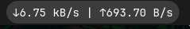
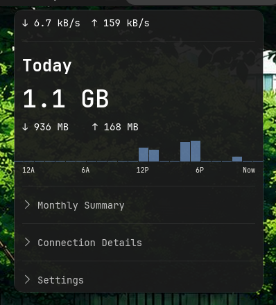

<p align="center">
  
</p>

<h1 align="center">Internet Speed Monitor</h1>

<p align="center">
  A COSMIC desktop applet that monitors internet speed and data usage in real time.
</p>

<p align="center">
  <a href="https://github.com/AceMythos/cosmic-internet-speed-monitor/blob/main/LICENSE">
    
  </a>
  <a href="https://www.rust-lang.org/">
    
  </a>
  <a href="https://github.com/pop-os/libcosmic">
    
  </a>
</p>

---

## Quick start

```sh
git clone https://github.com/AceMythos/cosmic-internet-speed-monitor && cd cosmic-internet-speed-monitor && cargo build --release && pkexec install -m 755 target/release/internet-speed-monitor /usr/bin/ && pkexec cp internet-speed-monitor.desktop /usr/share/applications/
```

Wi-Fi SSID & link speed require `iw`: `sudo apt install iw`

Then add it: **COSMIC Settings → Desktop → Panel → Add applet**.

---

## Features

- **Live speeds** — Download/upload rate in the panel, updated every second
- **Quota light** — 🟢 unlimited · 🔴 burning daily quota (blinks) · ⚪ unknown
- **Hourly sparkline** — Activity graph for the current day
- **Monthly bar chart** — Per-day totals with highest/average/lowest; click any bar for the value
- **Connection details** — IPv4, IPv6, gateway, DNS, interface, connection duration
- **Wi-Fi info** — SSID, signal strength, link speed
- **Configurable** — Refresh interval, speed units (bps/bytes), panel preset, interface, data retention (7–90 days)
- **Reset** — Clear today's or this month's stats

## Quota light (cell hotspot only)

Dot in the panel. Open the applet for detail.

| | Means |
|---|---|
| 🟢 | Unlimited data — no daily quota used |
| 🔴 | Burning your daily quota — the dot blinks |
| ⚪ | Don't know yet — see below |

The blink is on the red light only. Green and grey stay steady, so a blinking
dot always means the same thing. It pulses about once a second and dims rather
than disappearing, so it never reads as a broken applet.

**⚪ is normal on some phones.** Android won't tell a background app which
band it's on, so the applet can't always tell 5G-unlimited from
5G-burning-quota. It says ⚪ instead of guessing. It never shows 🟢 unless it
actually read `5G SA n78`.

If the phone sleeps, the applet keeps the last reading but marks it
**stale**. Stale is not the same as live.

Needs [a patched KDE Connect app](https://github.com/AceMythos/kdeconnect-android)
on the phone. Unpatched? The light just stays ⚪.

**If the light is wrong:** your carrier decides what to bill. This reads the
radio, not your account.

### The light can flip 🟢 ⇄ 🔴 while you're sitting on one band

This is the most surprising thing about the light, and it is not a bug.

Unlimited is keyed off the **`5G SA` token**, not the band number. The applet
treats these three readings differently even though the first two name the
*same band on the same tower*:

| Phone reports | Band | Verdict |
|---|---|---|
| `5G SA n78` | n78 | 🟢 Unlimited |
| `LTE n78` | n78 | 🔴 Burning |
| `5G SA n28` | n28 | ⚪ Unknown |

So when a phone oscillates between 5G standalone and an LTE fallback, the light
flips with it — even though the band never changed. Measured on a Jio handset
alternating roughly every 15 seconds, sometimes switching band entirely
(`n78` → `B5`) while staying on LTE.

Each flip fires a desktop notification, because the applet announces *both*
edges: unlimited becoming available, and unlimited stopping. That is deliberate —
losing unlimited is what starts eating your daily allowance.

If the flapping gets noisy, raising the **refresh interval** samples the phone
less often, so the applet reports fewer transitions. It won't stop the radio
from switching; it only stops the applet narrating every switch.

## Screenshots



## Configuration

| Setting | Default | Description |
|---|---|---|
| Refresh interval | 1s | How often to poll the network interface |
| Speed units | bps | bits per second or bytes per second |
| Panel preset | auto | Bandwidth graph style in the panel |
| Network interface | auto | Which interface to monitor |
| Data retention | 30 days | How long to keep historical stats (7–90) |

## Build from source

Requires Rust 1.80+ and a working COSMIC/Wayland session.

Full build & install instructions: [BUILD.md](BUILD.md)

```sh
git clone https://github.com/AceMythos/cosmic-internet-speed-monitor
cd cosmic-internet-speed-monitor
cargo build --release
```

## Logs

```sh
journalctl -p 3 -xb --user _EXE=/usr/bin/internet-speed-monitor
```

## Contributing

Bug reports, feature requests, and pull requests are welcome.

## License

[GPL-3.0-or-later](LICENSE)
