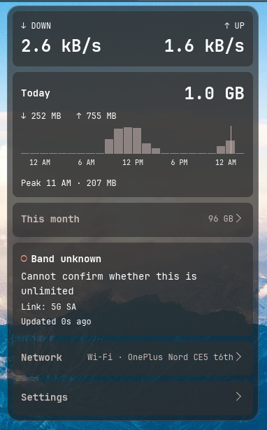
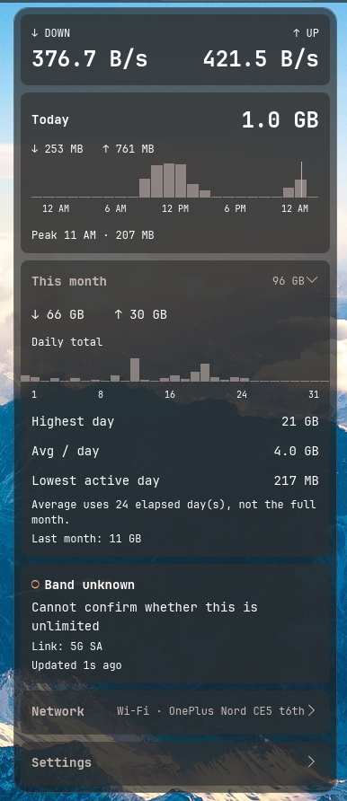

<p align="center">
  
</p>

<h1 align="center">Internet Speed Monitor</h1>

<p align="center">
  A COSMIC desktop applet that monitors internet speed and data usage in real time.
</p>

<p align="center">
  <a href="https://github.com/AceMythos/cosmic-internet-speed-monitor/blob/main/LICENSE">
    
  </a>
  <a href="https://www.rust-lang.org/">
    
  </a>
  <a href="https://github.com/pop-os/libcosmic">
    
  </a>
</p>

## Screenshots

| Connection details | Monthly summary |
|---|---|
|  |  |

---

## Quick start

```sh
git clone https://github.com/AceMythos/cosmic-internet-speed-monitor && cd cosmic-internet-speed-monitor && cargo build --release --locked && pkexec install -m 755 target/release/internet-speed-monitor /usr/bin/ && pkexec cp internet-speed-monitor.desktop /usr/share/applications/
```

Wi-Fi SSID & link speed require `iw`: `sudo apt install iw`

Then add it: **COSMIC Settings → Desktop → Panel → Add applet**.

---

## Features

- **Live speeds** — Download/upload rate in the panel, updated every second
- **Quota light** — Green circle: verified unlimited · red diamond: burning daily quota (blinks) · hollow circle: unknown, offline, or stale
- **Panel styles** — Compact text, Standard with a rolling sparkline, Detailed with today's total
- **Hourly sparkline** — Activity graph for the current day with a live "now" marker
- **Monthly bar chart** — Per-day totals with highest, average, and lowest values. Click any bar to see its value
- **Connection details** — IPv4, IPv6, gateway, DNS, interface, and session duration. Copy any value
- **Wi-Fi info** — SSID, signal strength, link speed
- **Configurable** — Refresh interval, speed units (bps/bytes), panel preset, interface, data retention (7–90 days)
- **Reset** — Clear today's or this month's stats, with confirmation

## Quota light (cell hotspot only)

Dot in the panel. Open the applet for detail.

| | Means |
|---|---|
| Green circle | Unlimited data — verified from a live `5G SA n78` reading |
| Red diamond | Burning your daily quota — the diamond blinks |
| Hollow circle | Unknown, offline, or stale — see below |

The blink is on the red diamond only. Green and hollow stay steady, so a
blinking shape always means the same thing. It pulses about once a second and
dims rather than disappearing, so it never reads as a broken applet.

**The hollow circle is normal on some phones.** Android won't tell a background
app which band it's on, so the applet can't always tell 5G-unlimited from
5G-burning-quota. It shows the hollow circle instead of guessing. It never
shows green unless a live reading actually said `5G SA n78`.

If the phone sleeps, the applet keeps the last reading but marks it
**stale**. A stale reading drops to the hollow circle, so a phone that goes
quiet cannot leave a false green dot in your panel. Stale is not the same as
live.

Needs [a patched KDE Connect app](https://github.com/AceMythos/kdeconnect-android)
on the phone. Unpatched? The light just stays ⚪.

**If the light is wrong:** your carrier decides what to bill. This reads the
radio, not your account.

### The light can flip 🟢 ⇄ 🔴 while you're sitting on one band

This is the most surprising thing about the light, and it is not a bug.

The applet uses the **`5G SA` token**, not the band number, to decide the
verdict. It treats these three readings differently even though the first two
name the *same band on the same tower*:

| Phone reports | Band | Verdict |
|---|---|---|
| `5G SA n78` | n78 | Green — unlimited |
| `LTE n78` | n78 | Red — burning |
| `5G SA n28` | n28 | Hollow — unknown |
| `5G NSA n78` | n78 | Hollow — unknown |

The applet deliberately does not treat NSA as burning. Whether NSA draws from
the daily allowance depends on the carrier, so the applet refuses to claim
either way.

So when a phone oscillates between 5G standalone and an LTE fallback, the light
flips with it — even though the band never changed. Measured on a Jio handset
alternating roughly every 15 seconds, sometimes switching band entirely
(`n78` → `B5`) while staying on LTE.

With notifications on, each unlimited ⇄ burning flip fires a desktop
notification, because the applet announces *both* edges: unlimited becoming
available, and unlimited stopping. That is deliberate — losing unlimited is
what starts eating your daily allowance. Transitions into or out of unknown
are silent, because they are not actionable and flap with the radio. Disable
notifications in Settings if you only want the panel light.

If the flapping gets noisy, increase the **refresh interval**. The applet
samples the phone less often and reports fewer transitions. The higher interval
does not stop the radio from switching. It only stops the applet from narrating
every switch.

## Configuration

| Setting | Default | Description |
|---|---|---|
| Refresh | 1 s | How often to poll the network interface |
| Units | bps | Bits per second or bytes per second |
| Panel style | Compact | Compact text, Standard adds a sparkline, Detailed adds today's total |
| Interface | auto | Which interface to monitor |
| Keep data | 30 days | Calendar days to keep, including today (7–90) |
| Quota notifications | On | Notify on unlimited ⇄ burning transitions |

## Build from source

Requires Rust 1.85+ (edition 2024) and a working COSMIC/Wayland session.

Full build & install instructions: [BUILD.md](BUILD.md)

```sh
git clone https://github.com/AceMythos/cosmic-internet-speed-monitor
cd cosmic-internet-speed-monitor
cargo build --release --locked
```

## Logs

```sh
journalctl -p 3 -xb --user _EXE=/usr/bin/internet-speed-monitor
```

## Data and privacy

- Stats stay on this machine in
  `$XDG_DATA_HOME/com.github.AceMythos.InternetSpeedMonitor/stats.json`
  (usually `~/.local/share/...`).
- The applet makes no network requests. The applet reads phone state locally
  from KDE Connect over D-Bus.
- Delete that directory. This deletes all history.

## Contributing

Bug reports, feature requests, and pull requests are welcome.

## License

[GPL-3.0-or-later](LICENSE)
