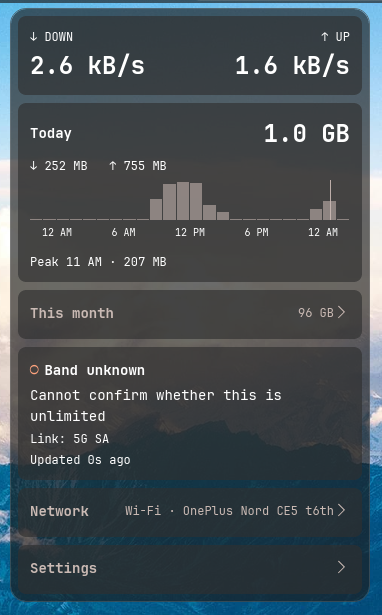
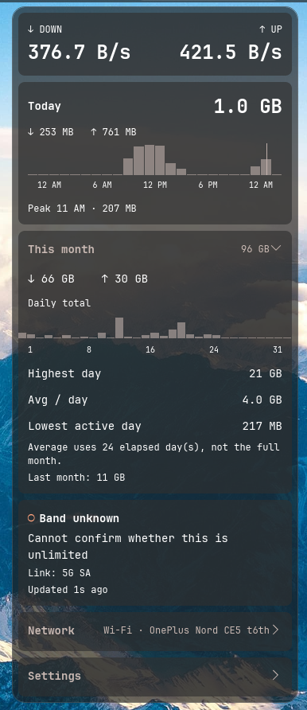

<p align="center">
  
</p>

<h1 align="center">Internet Speed Monitor</h1>

<p align="center">
  A COSMIC desktop applet that monitors internet speed and data usage in real time.
</p>

<p align="center">
  <a href="https://github.com/AceMythos/cosmic-internet-speed-monitor/blob/main/LICENSE">
    
  </a>
  <a href="https://www.rust-lang.org/">
    
  </a>
  <a href="https://github.com/pop-os/libcosmic">
    
  </a>
</p>

## Screenshots

| Connection details | Monthly summary |
|---|---|
|  |  |

---

## Install

Tested on Pop!_OS 24.04 with a COSMIC session. Other distros running COSMIC
should work, but are untested.

The first build downloads and compiles every dependency, so give it a few
minutes. Later builds are much faster.

### 1. Install the tools

Debian, Ubuntu, and Pop!_OS:

```sh
sudo apt install build-essential pkg-config libxkbcommon-dev iw
```

`iw` is only needed for the Wi-Fi name, signal strength, and link speed.

Now install Rust 1.85 or newer. Skip this if `cargo --version` already works:

```sh
curl --proto '=https' --tlsv1.2 -sSf https://sh.rustup.rs | sh
source "$HOME/.cargo/env"
```

### 2. Download the code

```sh
git clone https://github.com/AceMythos/cosmic-internet-speed-monitor
cd cosmic-internet-speed-monitor
```

No `git`? Download the ZIP with the green **Code** button on GitHub, extract it,
then `cd` into the extracted folder.

### 3. Build and install

```sh
./install.sh
```

The script builds the release binary, copies it to `/usr/bin`, registers the
applet, and asks whether to restart the panel. `pkexec` asks for your admin
password.

<details>
<summary>Prefer to do it by hand?</summary>

```sh
cargo build --release --locked
pkexec install -m 755 "$PWD/target/release/internet-speed-monitor" /usr/bin/internet-speed-monitor
pkexec install -m 644 "$PWD/internet-speed-monitor.desktop" /usr/share/applications/internet-speed-monitor.desktop
```

</details>

### 4. Add it to the panel

Open **COSMIC Settings → Desktop → Panel → Add applet** and pick
**Internet Speed Monitor**.

If it is not in the list, restart the panel:

```sh
killall cosmic-panel
```

The panel starts again on its own. If it does not, log out and back in.

### If something does not work

| Problem | Fix |
|---|---|
| "No such file or directory" when running `./install.sh` | You are not inside the project folder. Run `cd cosmic-internet-speed-monitor` first. |
| `cargo: command not found` | Rust is not installed, or the shell needs a restart. Run `source "$HOME/.cargo/env"`. |
| Build fails with a `pkg-config` error | Install the packages from step 1, then run `./install.sh` again. |
| Applet is missing from **Add applet** | Restart the panel (step 4) or log out and back in. |
| Wi-Fi name, signal, or link speed is empty | Install `iw`: `sudo apt install iw`. |
| Speed stays at zero | Open the applet and check that **Interface** picked the right adapter. |
| Quota light stays ⚪ | The light needs a patched KDE Connect on your phone. See [Quota light](#quota-light-cell-hotspot-only). |

### Uninstall

```sh
./uninstall.sh
```

It removes the binary and the applet entry, and asks before deleting your speed
history.

<details>
<summary>Manual uninstall, or if you deleted the folder</summary>

```sh
sudo rm -f /usr/bin/internet-speed-monitor /usr/share/applications/internet-speed-monitor.desktop
rm -rf "${XDG_DATA_HOME:-$HOME/.local/share}/com.github.AceMythos.InternetSpeedMonitor"
```

</details>

---

## Features

- **Live speeds** — Download/upload rate in the panel, updated every second
- **Quota light** — Green circle: verified unlimited · red diamond: burning daily quota (blinks) · hollow circle: unknown, offline, or stale
- **Panel styles** — Compact text, Standard with a rolling sparkline, Detailed with today's total
- **Hourly sparkline** — Activity graph for the current day with a live "now" marker
- **Monthly bar chart** — Per-day totals with highest, average, and lowest values. Click any bar to see its value
- **Connection details** — IPv4, IPv6, gateway, DNS, interface, and session duration. Copy any value
- **Wi-Fi info** — SSID, signal strength, link speed
- **Configurable** — Refresh interval, speed units (bps/bytes), panel preset, interface, data retention (7, 15, 30, 60, or 90 days)
- **Reset** — Clear today's or this month's stats, with confirmation

## Configuration

| Setting | Default | Description |
|---|---|---|
| Refresh | 1 s | How often to poll the network interface |
| Units | bps | Bits per second or bytes per second |
| Panel style | Compact | Compact text, Standard adds a sparkline, Detailed adds today's total |
| Interface | auto | Which interface to monitor |
| Keep data | 30 days | Days to keep, including today: 7, 15, 30, 60, or 90 |
| Quota notifications | On | Notify on unlimited ⇄ burning transitions |

## Quota light (cell hotspot only)

The applet draws one symbol next to the speeds in the panel. Open the applet for
detail.

| Panel symbol | Color | Means |
|---|---|---|
| `●` | Green | Unlimited data — verified from a live `5G SA n78` reading |
| `◆` | Red | Burning your daily quota — the diamond blinks |
| `○` | Amber | Unknown, offline, or stale — see below |

The hero screenshot at the top shows the `○` state.

The blink is on the red diamond only. Green and hollow stay steady, so a
blinking shape always means the same thing. It pulses about every 0.8 seconds
and dims rather than disappearing, so it never reads as a broken applet.

**The hollow circle is normal on some phones.** Android won't tell a background
app which band it's on, so the applet can't always tell 5G-unlimited from
5G-burning-quota. It shows the hollow circle instead of guessing. It never
shows green unless a live reading actually said `5G SA n78`.

If the phone sleeps, the applet keeps the last reading but marks it
**stale**. A stale reading drops to the hollow circle, so a phone that goes
quiet cannot leave a false green dot in your panel. Stale is not the same as
live.

Needs [a patched KDE Connect app](https://github.com/AceMythos/kdeconnect-android)
on the phone. Unpatched? The light just stays ⚪.

**If the light is wrong:** your carrier decides what to bill. This reads the
radio, not your account.

<details>
<summary>The light can flip 🟢 ⇄ 🔴 while you're sitting on one band</summary>

This is the most surprising thing about the light, and it is not a bug.

The applet uses the **`5G SA` token**, not the band number, to decide the
verdict. It treats these three readings differently even though the first two
name the *same band on the same tower*:

| Phone reports | Band | Verdict |
|---|---|---|
| `5G SA n78` | n78 | Green — unlimited |
| `LTE n78` | n78 | Red — burning |
| `5G SA n28` | n28 | Hollow — unknown |
| `5G NSA n78` | n78 | Hollow — unknown |

The applet deliberately does not treat a **5G NSA** reading as burning.
Whether NSA draws from the daily allowance depends on the carrier, so the
applet refuses to claim either way. A reading that names LTE is still treated
as burning, even when it carries an NSA token.

So when a phone oscillates between 5G standalone and an LTE fallback, the light
flips with it — even though the band never changed. Measured on a Jio handset
alternating roughly every 15 seconds, sometimes switching band entirely
(`n78` → `B5`) while staying on LTE.

With notifications on, each unlimited ⇄ burning flip fires a desktop
notification, because the applet announces *both* edges: unlimited becoming
available, and unlimited stopping. That is deliberate — losing unlimited is
what starts eating your daily allowance. Transitions into or out of unknown
are silent, because they are not actionable and flap with the radio. Disable
notifications in Settings if you only want the panel light.

If the flapping gets noisy, increase the **refresh interval**. The applet
samples the phone less often and reports fewer transitions. The higher interval
does not stop the radio from switching. It only stops the applet from narrating
every switch.

</details>

## Build from source

Already covered in [Install](#install). For the full build and update workflow,
see [BUILD.md](BUILD.md).

```sh
cargo build --release --locked
```

## Logs

```sh
journalctl -p 3 -xb --user _EXE=/usr/bin/internet-speed-monitor
```

This shows errors only, so no output means the applet has logged no errors.

## Data and privacy

- Stats stay on this machine in
  `$XDG_DATA_HOME/com.github.AceMythos.InternetSpeedMonitor/stats.json`
  (usually `~/.local/share/...`).
- The applet sends no data to the network. To find your local IP address it asks
  the kernel which local address would reach `1.1.1.1:53`; a UDP `connect`
  sends no packets. Phone state is read locally from KDE Connect over D-Bus.
- Delete that directory. This deletes all history.

## Contributing

Bug reports, feature requests, and pull requests are welcome.

## License

[GPL-3.0-or-later](LICENSE)
